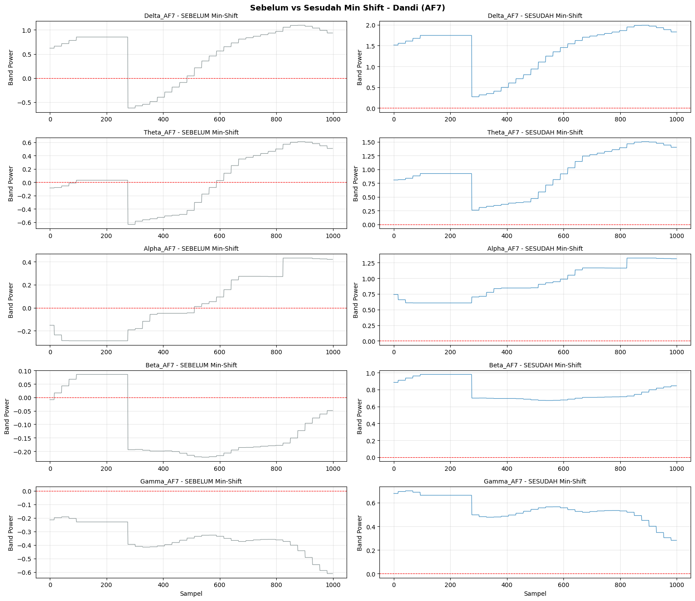
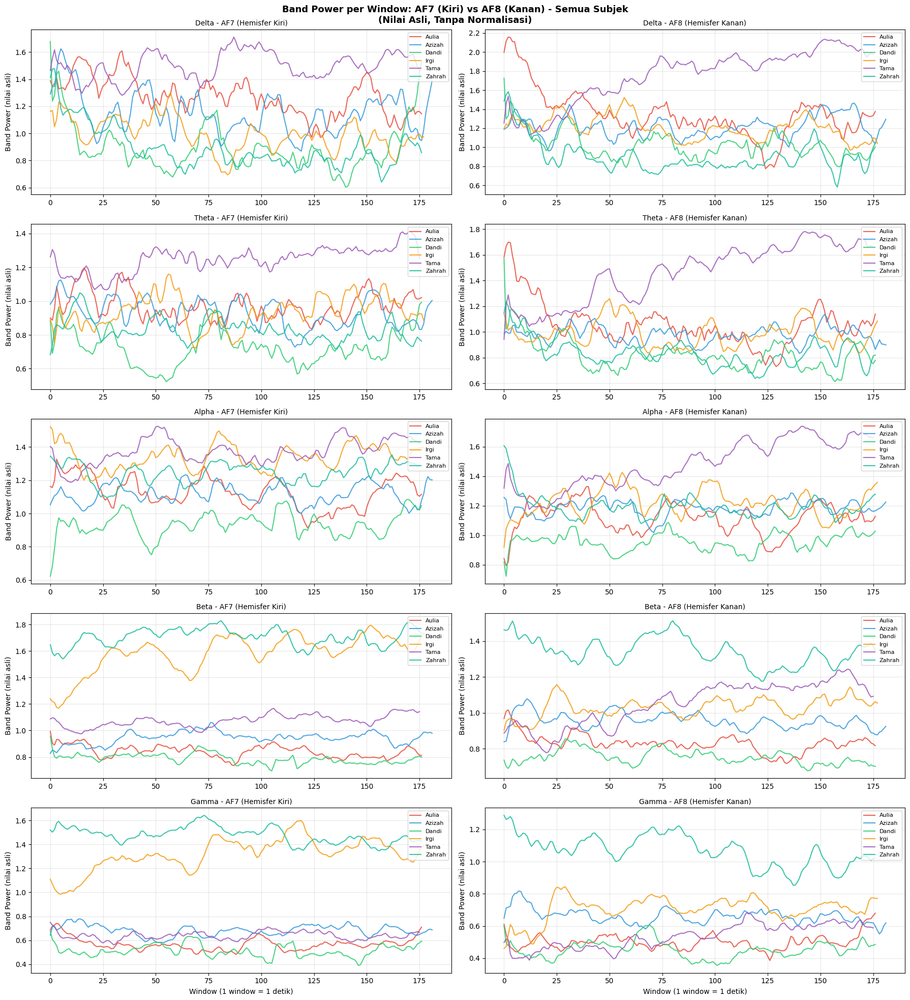
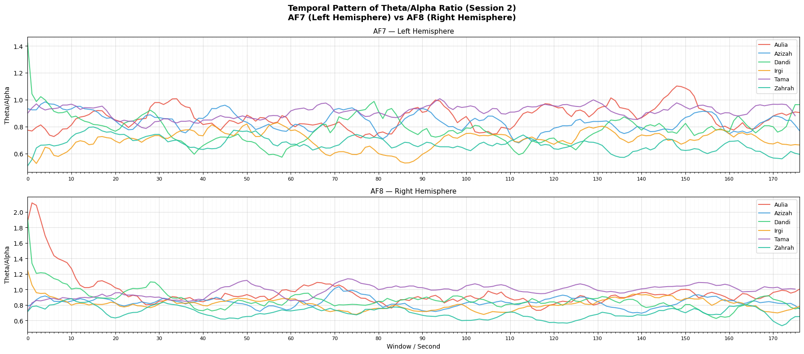
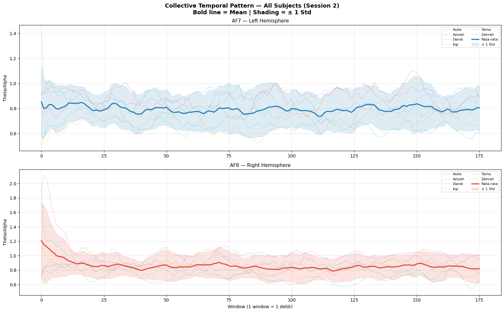
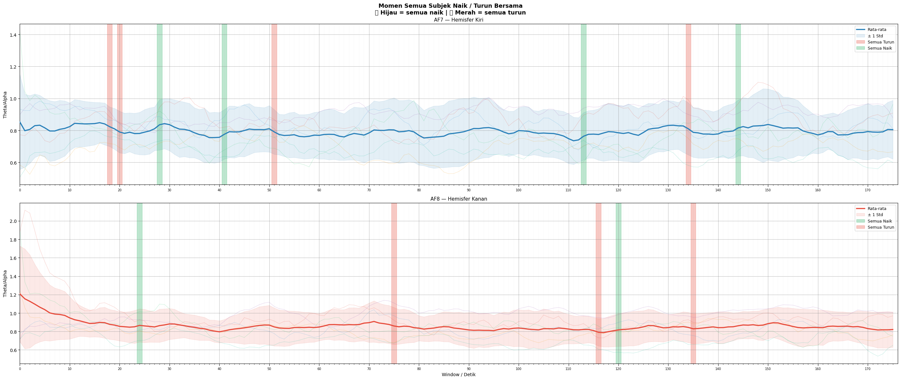
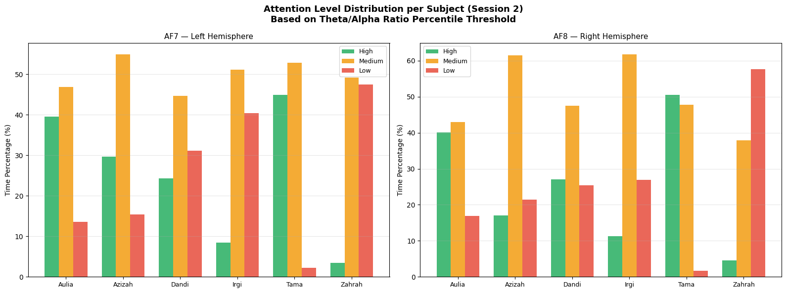

# Analisis Attention Span Berbasis EEG dengan Rasio Theta/Alpha pada Korteks Prefrontal (Muse Headband, 6 Subjek)

Analisis rekaman EEG dari enam subjek yang menonton video motivasi, menggunakan Muse headband pada sensor prefrontal AF7 (kiri) dan AF8 (kanan). Rasio Theta/Alpha dihitung per detik sebagai *Cognitive Load Index* (CLI), lalu dibandingkan antar hemisfer, antar subjek, dan terhadap isi video. Proyek kelompok (Topik Khusus Kecerdasan Buatan, Departemen Teknik Informatika, Universitas Hasanuddin). Cakupan repositori ini adalah **Sesi 2** (6 Mei 2026).

## Ringkasan

- **Data:** 6 subjek, 1 sesi, durasi rekaman 175,5 sampai 180,5 detik, 45.065 sampai 46.266 baris per subjek.
- **Fitur:** rata-rata band power (Delta, Theta, Alpha, Beta, Gamma) pada AF7 dan AF8 per window 1 detik. CLI = Theta / (Alpha + 1e-9).
- **Temuan utama:** CLI rata-rata lebih tinggi di AF8 pada 5 dari 6 subjek. Uji Wilcoxon Signed-Rank pada window menunjukkan 4 subjek berbeda signifikan (seluruhnya AF8 > AF7).
- **Temuan lain:** ada beberapa momen ketika CLI keenam subjek naik atau turun bersamaan, yang dipetakan ke scene video. Profil level CLI berbeda antar subjek.

## Pipeline

1. **Seleksi kolom.** Dari 44 kolom CSV dipertahankan 10 kolom band power (5 pita × AF7/AF8).
2. **Missing values.** Interpolasi linear dua arah. Tidak ada baris yang dihapus pada Sesi 2.
3. **Koreksi baseline (global min-shift).** Seluruh nilai digeser dengan nilai minimum global (−0,8930) agar tidak ada nilai negatif.
4. **Sliding window.** Window 1 detik berbasis timestamp. Window dengan kurang dari 10 sampel dibuang, menghasilkan 176 sampai 182 window per subjek.
5. **CLI.** Rasio Theta/Alpha per window untuk AF7 dan AF8.
6. **Analisis.** Statistik deskriptif, uji Wilcoxon AF7 vs AF8, pola temporal bersama (rata-rata dan standar deviasi lintas subjek), deteksi momen naik/turun bersama (delta CLI setelah smoothing rolling mean 10 window), pemetaan ke scene video, dan pengelompokan level CLI berdasarkan persentil.





## Hasil

### Statistik CLI per subjek

| | Aulia | Azizah | Dandi | Irgi | Tama | Zahrah |
| ----- | ----- | ----- | ----- | ----- | ----- | ----- |
| AF7 rata-rata | 0,8692 | 0,8342 | 0,7805 | 0,7009 | 0,9083 | 0,6702 |
| AF8 rata-rata | 0,9401 | 0,8274 | 0,8519 | 0,8073 | 0,9870 | 0,6993 |
| Selisih (AF7 − AF8) | −0,0709 | +0,0069 | −0,0714 | −0,1063 | −0,0787 | −0,0292 |
| CLI lebih tinggi di | AF8 | AF7 | AF8 | AF8 | AF8 | AF8 |



### Uji Wilcoxon Signed-Rank (AF7 vs AF8, α = 0,05)

| Subjek | W | p-value | Keputusan | Arah |
| ----- | ----- | ----- | ----- | ----- |
| Aulia | 5408 | 0,0003 | Signifikan | AF8 > AF7 |
| Azizah | 8139 | 0,7922 | Tidak signifikan | - |
| Dandi | 4983 | < 0,0001 | Signifikan | AF8 > AF7 |
| Irgi | 2947 | < 0,0001 | Signifikan | AF8 > AF7 |
| Tama | 4016 | < 0,0001 | Signifikan | AF8 > AF7 |
| Zahrah | 6557 | 0,0533 | Tidak signifikan | - |

### Pola temporal bersama dan momen serentak



Momen ketika CLI seluruh subjek naik atau turun bersamaan (deteksi pada delta CLI setelah smoothing):

| Saluran | Arah | Detik ke- |
| ----- | ----- | ----- |
| AF7 | Semua naik | 27-28, 40-42, 112-113, 143-144 |
| AF7 | Semua turun | 17-21, 50-52, 133-135 |
| AF8 | Semua naik | 23-24, 118-120 |
| AF8 | Semua turun | 74-74, 115-116, 134-135 |



Pemetaan momen "semua naik" ke scene video:

| Saluran | Detik | Scene |
| ----- | ----- | ----- |
| AF8 | 23-24 | Ibu dan anak mengemis pertama kali muncul |
| AF7 | 27-28 | Papan "For education" dan pemuda membuka dompet |
| AF7 | 40-42 | Nenek tua dan pertanyaan retoris narrator |
| AF7 | 112-113 | Anak berseragam dan ekspresi haru pemuda |
| AF8 | 118-120 | Anak berseragam dan ekspresi haru pemuda |
| AF7 | 143-144 | Pemuda makan pisang dan pesan "Reaches a deeper understanding" |

Momen-momen tersebut cenderung muncul pada scene bermuatan sosial, moral, reflektif, atau emosional. Pemetaan ini bersifat deskriptif.

### Level CLI per subjek

Window dikelompokkan berdasarkan persentil gabungan seluruh subjek: di atas persentil ke-75 (High), di antara persentil ke-25 dan ke-75 (Medium), dan di bawah persentil ke-25 (Low). Pada notebook, kategori ini diberi label *attention level*.

| | AF7 High | AF7 Medium | AF7 Low | AF8 High | AF8 Medium | AF8 Low |
| ----- | ----- | ----- | ----- | ----- | ----- | ----- |
| Aulia | 39,5% | 46,9% | 13,6% | 40,1% | 42,9% | 16,9% |
| Azizah | 29,7% | 54,9% | 15,4% | 17,0% | 61,5% | 21,4% |
| Dandi | 24,3% | 44,6% | 31,1% | 27,1% | 47,5% | 25,4% |
| Irgi | 8,4% | 51,1% | 40,4% | 11,2% | 61,8% | 27,0% |
| Tama | 44,9% | 52,8% | 2,3% | 50,6% | 47,7% | 1,7% |
| Zahrah | 3,4% | 49,2% | 47,5% | 4,5% | 37,9% | 57,6% |



## Catatan Interpretasi

Dalam literatur, rasio Theta/Alpha yang lebih tinggi dikaitkan dengan beban kognitif yang lebih besar atau dengan kantuk dan perhatian yang lebih rendah, bergantung pada konteks tugas. Pada proyek ini kategori High/Medium/Low hanya menunjukkan posisi nilai CLI terhadap persentil gabungan seluruh subjek. Kategori tersebut belum divalidasi sebagai ukuran atensi, sehingga hasilnya sebaiknya dibaca sebagai indikator dinamika CLI, bukan sebagai ukuran absolut fokus.

## Keterbatasan

- **Jumlah subjek kecil (6) dan satu sesi.** Hasil belum dapat digeneralisasi. Perbandingan antar sesi tidak dicakup di repositori ini.
- **Perangkat consumer-grade.** Muse rentan terhadap noise, artefak gerakan, dan kualitas kontak elektroda.
- **Belum ada validasi subjektif.** Tidak ada kuesioner atau self-report pasca-stimulus, sehingga kenaikan CLI belum dapat dikaitkan langsung dengan pengalaman subjek.
- **Skala nilai band power.** Nilai negatif ditemukan pada seluruh pita (Gamma hampir seluruhnya negatif), yang mengindikasikan skala logaritmik (dB). Rasio dihitung pada nilai setelah min-shift, sehingga bukan rasio daya linear dan nilainya bergantung pada konstanta pergeseran. Skala ini belum diverifikasi terhadap dokumentasi perangkat atau aplikasi ekspor.
- **Awal rekaman.** Pada beberapa subjek, rasio AF8 tampak tinggi pada sekitar 10 detik pertama. Bagian awal tidak dibuang dan dapat memengaruhi rata-rata AF8.
- **Uji pada window berurutan.** Wilcoxon dijalankan pada window berurutan yang saling berkorelasi, sehingga p-value kemungkinan terlalu optimistis. Uji pada tingkat subjek (n = 6) menggunakan selisih rata-rata di tabel di atas menghasilkan p = 0,0625 (Wilcoxon exact, dua sisi), meskipun 5 dari 6 subjek berarah AF8 > AF7.
- **Momen serentak belum diuji terhadap kebetulan.** Belum ada pembanding acak (misalnya permutation atau circular shift per subjek), dan pemetaan ke scene bersifat deskriptif.

## Struktur Repositori

```
├── notebook/
│   └── eeg_attention_session2.ipynb
├── assets/
├── report/
│   └── Laporan EEG.pdf
└── readme.md
```

## Tim

Proyek kelompok. 
Nama anggota:
1. Nadia Indriani Sumardi
2. Azizah Awaliyah